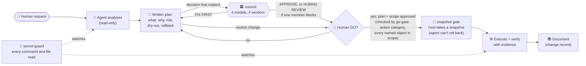
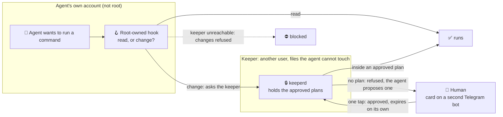

# agent-ops-guardrails

**An operating model for an AI agent that runs real infrastructure: the guardrails, the method, and the field notes.**

I let an AI agent run my homelab: a hypervisor, about forty containers, backups and a VPN. The agent is Claude Code; the reviewers in the council come from four different vendors. It has broad access to all of it, and it is good at the work. It is also confidently wrong a few times a week, and early on it printed secrets into its own transcript.

This repo collects the guardrails that grew around it. Each one exists because something went wrong once.

## The principle in one picture

Each layer answers one way an AI ops agent fails. None of them is enough alone.

### The keeper in one picture

The picture above is the *method*. This one is the strongest *mechanism*: who may say yes, and why the agent cannot say it to itself.

**What these guardrails are, and are not.** They catch the mistakes of a *cooperative* agent: a careless command, a plan it didn't run past the human, a secret that slipped into a transcript. They are hooks that run with the agent's own rights and judge the text it writes, so an agent that *tries* to get around them can: an external audit of v0.8 did it 16 ways for secret-guard alone (all closed in v0.9, but the class remains). Against an agent that tries to get around them, the approval must live in a separate process the agent cannot write to. That is the [**keeper**](keeper/) (v1.0 on a workstation; server deployment experimental):
- it runs under its own user;
- approvals come from button presses on a second Telegram bot that only it can read;
- the hook is root-owned and registered in managed settings;
- it requires an agent whose own account is **not root** (otherwise the agent could edit the keeper itself): the installer refuses root.

It ran on my laptop in observe mode from 08/10/2026, then switched to block mode on 12/10/2026 after an end-to-end dry run (checklist in [docs/block-mode-dry-run.md](docs/block-mode-dry-run.md)); every change the agent makes on that machine now goes through an approval card on the second Telegram bot. Block mode ran there for nine days of everyday work; v1.0 (21/10/2026) is the keeper on one workstation. Its server deployment is documented and has a read-only checker, but it has not been applied to a real host, so it stays experimental. Output filtering (secret-guard) still runs in the agent's process.

Two claims, and only the first is strong: the **approval cannot be forged** by the agent (separate user, button on a bot it cannot read, root-owned hook); but **what counts as a change is decided by a heuristic classifier**, not a proof. A review on 08/10 found a class of "read" commands that actually execute or write through an option or a config file, now fixed and tested (K1-K9 in the [design's Known limits](docs/design-keeper.md#known-limits-be-precise-about-what-is-proven)). Do not read "unforgeable approval" as "the agent cannot act without approval": the gate is as good as the classifier, and `actions=script` is unbounded by design.

| Failure mode of the agent | Guardrail | Status |
|---|---|---|
| Confidently wrong plan: a wrong diagnosis, an inconsistent threshold, a missed risk | [**council/**](council/): four models from different vendors review the written plan. The verdict is computed from their votes, and a lone blocking objection is never merged away. | ✅ code |
| Prints a secret by accident (`docker inspect`, `crontab -l`, an error message carrying a URL with credentials) | [**secret-guard/**](secret-guard/): a hook refuses commands that may print secrets unless their whole output goes through a masking filter, and blocks direct reads of secret files. | ✅ code |
| A secret ends up in a transcript anyway (no pattern list is complete) | [**leak-check/**](leak-check/): a root job looks for the *real* secret values (env, compose, app configs, URLs, private keys) in what the agent produced, on the server and, after a daily copy, on the laptop. Each run starts with a canary. A hit is a leak, not a guess. | ✅ code |
| Acts without being asked, or beyond what was approved | [**go-gate/**](go-gate/): a hook that allows changes only inside a plan the human approved with a GO (scope + expiry). Reads stay free. Observe mode by default. | 🧪 code, experimental |
| Forges, replays or removes that approval itself | [**keeper/**](keeper/): a daemon under its own user holds the approvals, and the human approves with a button on a separate bot. The hook is root-owned and fails closed. Requires an agent that is not root. | ✅ v1.0 on a workstation; 🧪 server deployment experimental |
| Skips checks | **Change procedure**: analyse → plan → explicit GO → dry-run → execute → verify with evidence → document. | 📄 [described](docs/method.md#1-the-change-procedure) |
| Breaks something during an upgrade | **Snapshot gate**: the agent *requests* a snapshot; the host takes it. The agent can never roll back or delete. | 📄 [described](docs/method.md#3-an-on-call-agent-that-cannot-undo) |
| Has too much power when working alone | **On-call restrictions**: a least-privilege role, and denial tests that are harmless if they unexpectedly succeed. | 📄 [described](docs/method.md#4-denial-tests-must-be-harmless) |

## Start here

- **For managers and CIOs:** a five-minute, non-technical read: [docs/for-it-leaders.md](docs/for-it-leaders.md) ([version française](docs/fr/pour-les-dirigeants-it.md)).
- **See what you get:** a real [council report](examples/council-report.md) and the hook's real [refusals](examples/secret-guard-refusals.md).
- **Install secret-guard:** `./install.sh` (add `--write-settings` to register the hook in `~/.claude/settings.json`; a backup is made).
- **Questions?** The [FAQ](docs/faq.md) covers: why several LLMs, cost, use with other agents, false positives, limits, adapting it to your setup.
- **Review plans with several models:** [council/README.md](council/README.md). Works with any OpenAI-compatible endpoint.
- **Stop secret leaks in Claude Code:** [secret-guard/README.md](secret-guard/README.md). Two files to install, plus a settings snippet.
- **Measure real leaks, not pattern scores:** [leak-check/README.md](leak-check/README.md). It found 7 real leaks the pattern hook had missed. Its inventory covers 53% of what gitleaks flags, measured and broken down.
- **Make the GO mechanical (experimental):** [go-gate/README.md](go-gate/README.md). Start with `simulate.py` on your own history, then a week in observe mode.
- **Make the approval unforgeable (v1.0 on a workstation; the server deployment is experimental):** [keeper/README.md](keeper/README.md), with the [design and threat model](docs/design-keeper.md). Its installer only does a dry run unless you pass `--apply`. Covering a root agent and a server with no human watching (standing plans): [docs/design-keeper-server.md](docs/design-keeper-server.md).
- **Give a non-root agent filtered Docker access, never the `docker` group (experimental):** [docker-proxy/README.md](docker-proxy/README.md), design in [docs/design-keeper-server.md](docs/design-keeper-server.md) section 1. Its installer only does a dry run unless you pass `--apply`. Known limit: `inspect` and `logs` output is masked, but `docker top` and `docker stats` output is not (process arguments can contain secrets).
- **The whole method and the incidents behind it:** [docs/method.md](docs/method.md).

## Results, honestly

[docs/results.md](docs/results.md) opens with one table of every measure, its value, and how independent it is. In short:
- **council:** a backtest on my agent's real past mistakes, what it caught, and its false alarms;
- **secret-guard:** 75–85% agreement with blind test sets written by other models, a measure of coverage, not of leaks;
- **leak-check:** real leaks found in real transcripts. It is a floor, not a total: each report says what was checked.

go-gate's [simulation](go-gate/README.md#our-numbers-simulation-before-installing) on 11,000 past tool calls: only about 45% of the agent's changes came within 2 h of a short explicit approval (a measure of proximity in time, not a replay). That is the reason the gate exists, and the reason it starts in observe mode.

These are one person's field notes, not a benchmark.

## How this compares

As read on 2026-10-11, from each project's own README/landing page or primary documentation (no blog posts, no
sponsored write-ups). Quotes are paraphrased from the cited page; "not verified" means the page does not say and no
other primary source was checked. These are young, mostly single-maintainer projects, including this one: none of
this is an endorsement, and a thin or missing cell is not evidence of absence, only that the page does not say.

| Project | Approval lives | Covers | Granularity | Out-of-band channel | Observe mode | Audit log | Secrets kept from the model |
|---|---|---|---|---|---|---|---|
| **keeper** (this repo) | Separate user (`_keeper`/`keeper` daemon); go-gate alone is same-process | Every tool call, via go-gate's classifier | Per plan (scope + TTL), checked call by call | Yes — a second Telegram bot the agent cannot read | Yes, default | Plain JSON lines (`log.jsonl`); not hash-chained or signed | **No.** Output filtering is secret-guard's job, in the agent's own process (keeper/README.md, "What the keeper does and does not guarantee") |
| [tarides/sudo-proxy](https://github.com/tarides/sudo-proxy) | Same terminal as the human approver; a separate machine when used over SSH | Its own `execute` tool (shell), not other tool calls | Per command, no auto-approve | No — the keypress is in the same terminal flow, not a separate channel | Not documented | Only with `-v`; format not documented | Yes, claimed: no password stored, "sanitized allowlist" environment |
| [luisgf/infrabroker](https://github.com/luisgf/infrabroker) | Separate process (`cmd/signer`) in server mode; same process in local/quickstart mode | SSH and Kubernetes only | Per command (SSH); per verb/resource/namespace (k8s) | Yes, an optional control-plane `/v1/approvals/{id}` endpoint (channel not named) | Yes, action budgets ("observe or enforce"); dry-run for commands | Yes, strong: append-only, Ed25519-signed, SHA-256-chained | Yes, explicit: "nothing enters the model's context" |
| [BrightbeamAI/chap](https://github.com/BrightbeamAI/chap) | Not specified — coordinator can be "embedded in your own process or run as a server" | Work artefacts (diffs, tasks, reviews); an MCP gate exists but its scope isn't detailed | Per artefact (e.g. a diff), not per command | Not described | Yes, named ("shadow and trial modes"), no details given | Yes, strong: hash-chained, optional transparency log | Not verified |
| [lacs-project/sysknife](https://github.com/lacs-project/sysknife) | Separate process **and** separate user (privileged daemon) | A catalogue of 192 typed actions only — "the AI never supplies a command" (though some actions still run via `sh -c`, built by SysKnife itself) | Per step, with a transaction id; `--yes` can skip up to a risk ceiling | Yes, the terminal ("a channel the model does not sit on"); Telegram is roadmap only | `--dry-run` (plan only) and a read-only observer role | Yes, strong: hash-chained SQLite/Postgres, Ed25519-signed | Not verified |
| [OthmaneBlial/term_mcp_deepseek](https://github.com/OthmaneBlial/term_mcp_deepseek) | Local web UI on the same machine (`127.0.0.1:8000`); not stated as a separate OS user | Shell commands ("parsed without a shell"); coverage of non-shell tool calls not verified | Attaches to a versioned plan, not clearly per command | Not documented — approval is in the same local UI | `inspect` mode is read-only by default, but the README does not say it blocks execution | Yes: signed receipts per action | Not verified |
| [Proofpane](https://github.com/Proofpane/releases) | Local MCP daemon on the same machine (stdio); **daemon is closed-source** | Claims coding agents, workflow tools and LLM APIs; the daemon itself ships 13 tools and its own `coverage` command admits "ungoverned" paths exist | Per call, claimed | "Pause for a human" / "human-approval gates" mentioned, channel not documented | Not documented | Claimed: SHA-256 hash-chained, Ed25519-anchored — **not verifiable, the daemon's code is proprietary** | Claimed for the daemon's mediated tools — **not verifiable, closed-source** |
| LangGraph `interrupt()` — **not verified (official docs unreachable on 2026-10-11)** ([docs](https://docs.langchain.com/oss/python/add-human-in-the-loop); human-in-the-loop pattern used in NirDiamant/agents-towards-production's `tutorials/arcade-secure-tool-calling`) | **Same process as the agent.** The canonical example pauses with an `InMemorySaver` checkpointer — in-memory, not persisted — and resumes via a `Command` sent into that same thread | Whatever node the developer wraps in `interrupt()`; not an automatic gate over every tool call | Per interrupt point, as placed by the developer — no built-in per-plan concept | **No.** Resuming means calling back into the same process/thread; no separate channel is built in | Not a built-in concept | Not a built-in concept — would have to be custom-built on top of checkpointer state | Not addressed by the primitive; left to the application |

**Where others are stronger than this project, plainly:** infrabroker, sysknife and (on paper) chap and Proofpane
sign and hash-chain their audit log; keeper's `log.jsonl` is a plain, unsigned file an operator with disk access
could edit. sysknife's typed-action catalogue is a stronger guarantee than go-gate's heuristic classifier — "the AI
never supplies a command" closes a whole class of disguise this project can only chase case by case (see
[go-gate/test_disguise.py](go-gate/test_disguise.py)). infrabroker states outright that secrets never enter the
model's context; this project does not make that claim for keeper itself, only for secret-guard, which runs
in-process.

**Not verified:** sysknife and term_mcp_deepseek make no claim about secrets reaching the model; chap gives no
detail on its out-of-band channel, MCP-gate scope or model secrecy; Proofpane's audit-log and secret-masking claims
could not be checked past its README, since the daemon implementing them is proprietary; the whole LangGraph
`interrupt()` row rests on a secondary summary of the official docs (a search result quoting them), not a direct
read — `docs.langchain.com` could not be reached from this environment on 2026-10-11, checked three times.

## License

MIT. Personal project by [renocz](https://github.com/renocz).
