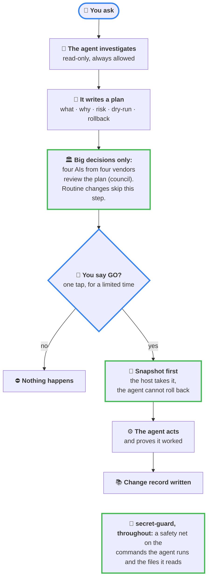
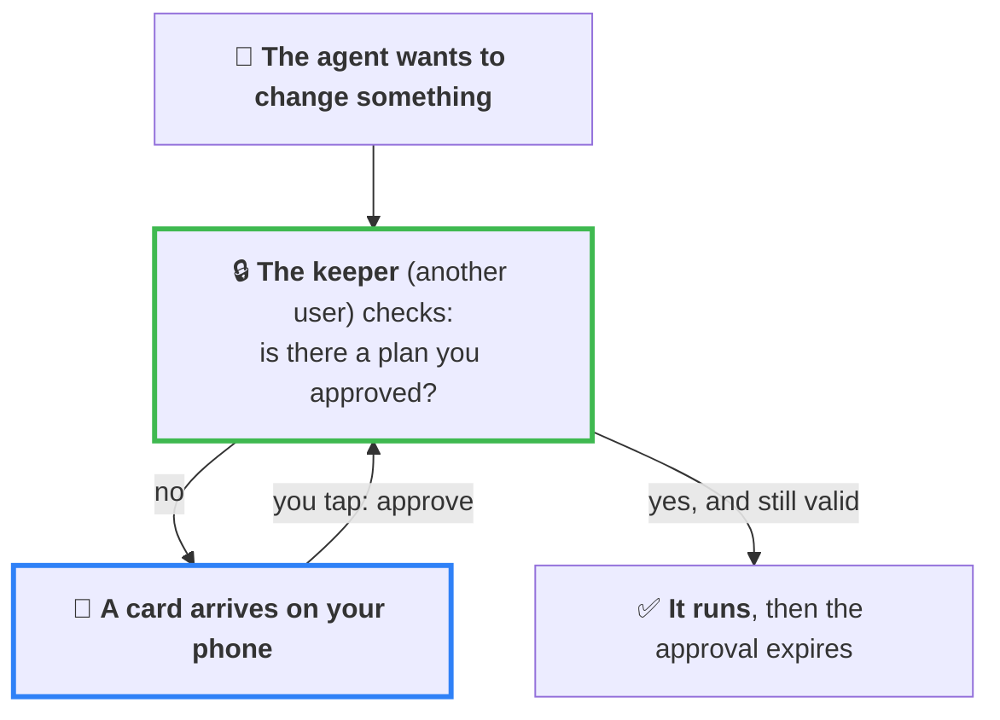
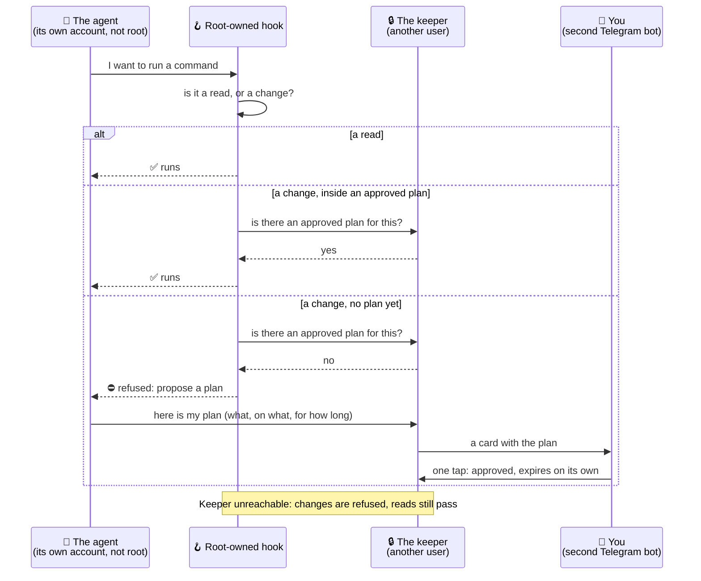

# agent-ops-guardrails

**Let an AI agent run your servers, without letting it approve its own actions.**

In one minute:
- The agent reads and analyses freely.
- Anything the system recognises as a change waits for a human yes: one tap on your phone, valid for a limited time.
- The agent cannot give itself that yes: the approval lives in a separate service it cannot touch, and the agent must not run as root.

v1.0 covers this approval step on one workstation; the server deployment is experimental. It catches an agent's mistakes and tricks, not a determined attacker, and the sorting of commands is a set of rules, not a proof. The [limits](#limits-stated-precisely) are written down, not hidden.

I let an AI agent run my homelab: a hypervisor, about forty containers, backups and a VPN. The agent is Claude Code; the reviewers in the council come from four different vendors. It has broad access to all of it, and it is good at the work. It is also confidently wrong a few times a week, and early on it printed secrets into its own transcript.

This repo collects the guardrails that grew around it. Each one exists because something went wrong once.

## Start here: pick your path

- **I am a manager or a CIO** (five minutes, no code): [docs/for-it-leaders.md](docs/for-it-leaders.md) ([version française](docs/fr/pour-les-dirigeants-it.md)).
- **I am an engineer:** the [FAQ](docs/faq.md) (why several LLMs, cost, use with other agents, the keeper, false positives, limits), then [keeper/README.md](keeper/README.md) to install the approval step (its installer only does a dry run unless you pass `--apply`).
- **I want to see it first:** a real [council report](examples/council-report.md) and the hook's real [refusals](examples/secret-guard-refusals.md).

## The principle in one picture

Each step answers one way an AI ops agent fails. None of them is enough alone. Blue = a human decides; green = a guardrail checks.

## The keeper, in plain words

The strongest piece is the [**keeper**](keeper/) (v1.0 on a workstation; server deployment experimental). It answers one question: who may say yes, and why the agent cannot say it to itself.

1. The agent asks to change something.
2. A card with its plan arrives on your phone. You approve it with one tap.
3. It runs, for a limited time, and the approval expires on its own.

The agent cannot press that button itself: the button lives in a separate service, under another user, on a second Telegram bot only that service can read.

The same thing, step by step (who talks to whom)

What makes it hold:
- it runs under its own user;
- approvals come from button presses on a second Telegram bot that only it can read;
- the hook is root-owned and registered in managed settings;
- it requires an agent whose own account is **not root** (otherwise the agent could edit the keeper itself): the installer refuses root.

Track record: it ran on my laptop in observe mode for four days, then in block mode for nine days of everyday work, after an end-to-end dry run (checklist in [docs/block-mode-dry-run.md](docs/block-mode-dry-run.md)). On that machine, every change the classifier recognises as a change goes through an approval card. v1.0 is the keeper on one workstation: the nine days ran on macOS, while the automated tests and CI run on Linux, so the macOS installer path has no automated test. Its server deployment is documented and has a read-only checker, but it has not been applied to a real host, so it stays experimental.

### Limits, stated precisely

What these guardrails are, and are not (read this before relying on them)

They catch the mistakes of a *cooperative* agent: a careless command, a plan it didn't run past the human, a secret that slipped into a transcript. They are hooks that run with the agent's own rights and judge the text it writes, so an agent that *tries* to get around them can: an external audit of v0.8 did it 16 ways for secret-guard alone (all closed in v0.9, but the class remains). Against an agent that tries to get around them, the approval must live in a separate process the agent cannot write to. That is what the keeper is for. Output filtering (secret-guard) still runs in the agent's own process.

Two claims, and only the first is strong: the **approval cannot be forged** by the agent (separate user, button on a bot it cannot read, root-owned hook); but **what counts as a change is decided by a heuristic classifier**, not a proof. A review on 08/10 found a class of "read" commands that actually execute or write through an option or a config file, now fixed and tested (K1-K9 in the [design's Known limits](docs/design-keeper.md#known-limits-be-precise-about-what-is-proven)). Do not read "unforgeable approval" as "the agent cannot act without approval": the gate is as good as the classifier, and `actions=script` is unbounded by design.

## What each piece guards against

| Failure mode of the agent | Guardrail | Status |
|---|---|---|
| Confidently wrong plan: a wrong diagnosis, an inconsistent threshold, a missed risk | [**council/**](council/): four models from different vendors review the written plan. The verdict is computed from their votes, and a lone blocking objection is never merged away. | ✅ code |
| Prints a secret by accident (`docker inspect`, `crontab -l`, an error message carrying a URL with credentials) | [**secret-guard/**](secret-guard/): a hook refuses commands that may print secrets unless their whole output goes through a masking filter, and blocks direct reads of secret files. | ✅ code |
| A secret ends up in a transcript anyway (no pattern list is complete) | [**leak-check/**](leak-check/): a root job looks for the *real* secret values (env, compose, app configs, URLs, private keys) in what the agent produced, on the server and, after a daily copy, on the laptop. Each run starts with a canary. A hit is a leak, not a guess. | ✅ code |
| Acts without being asked, or beyond what was approved | [**go-gate/**](go-gate/): a hook that allows changes only inside a plan the human approved with a GO (scope + expiry). Reads stay free. Observe mode by default. | 🧪 code, experimental |
| Forges, replays or removes that approval itself | [**keeper/**](keeper/): a daemon under its own user holds the approvals, and the human approves with a button on a separate bot. The hook is root-owned and fails closed. Requires an agent that is not root. | ✅ v1.0 on a workstation; 🧪 server deployment experimental |
| Skips checks | **Change procedure**: analyse → plan → explicit GO → dry-run → execute → verify with evidence → document. | 📄 [described](docs/method.md#1-the-change-procedure) |
| Breaks something during an upgrade | **Snapshot gate**: the agent *requests* a snapshot; the host takes it. The agent can never roll back or delete. | 📄 [described](docs/method.md#3-an-on-call-agent-that-cannot-undo) |
| Has too much power when working alone | **On-call restrictions**: a least-privilege role, and denial tests that are harmless if they unexpectedly succeed. | 📄 [described](docs/method.md#4-denial-tests-must-be-harmless) |

## The pieces, and how to use them

- **Install secret-guard:** `./install.sh` (add `--write-settings` to register the hook in `~/.claude/settings.json`; a backup is made).
- **Review plans with several models:** [council/README.md](council/README.md). Works with any OpenAI-compatible endpoint.
- **Stop secret leaks in Claude Code:** [secret-guard/README.md](secret-guard/README.md). Two files to install, plus a settings snippet.
- **Measure real leaks, not pattern scores:** [leak-check/README.md](leak-check/README.md). It found 7 real leaks the pattern hook had missed. Its inventory covers 53% of what gitleaks flags, measured and broken down.
- **Make the GO mechanical (experimental):** [go-gate/README.md](go-gate/README.md). Start with `simulate.py` on your own history, then a week in observe mode.
- **Make the approval unforgeable (v1.0 on a workstation; the server deployment is experimental):** [keeper/README.md](keeper/README.md), with the [design and threat model](docs/design-keeper.md). Its installer only does a dry run unless you pass `--apply`. Covering a root agent and a server with no human watching (standing plans): [docs/design-keeper-server.md](docs/design-keeper-server.md).
- **Give a non-root agent filtered Docker access, never the `docker` group (experimental):** [docker-proxy/README.md](docker-proxy/README.md), design in [docs/design-keeper-server.md](docs/design-keeper-server.md) section 1. Its installer only does a dry run unless you pass `--apply`. Known limit: `inspect` and `logs` output is masked, but `docker top` and `docker stats` output is not (process arguments can contain secrets).
- **The whole method and the incidents behind it:** [docs/method.md](docs/method.md).

## Results, honestly

[docs/results.md](docs/results.md) opens with one table of every measure, its value, and how independent it is. In short:
- **council:** a backtest on my agent's real past mistakes, what it caught, and its false alarms;
- **secret-guard:** 75–85% agreement with blind test sets written by other models, a measure of coverage, not of leaks;
- **leak-check:** real leaks found in real transcripts. It is a floor, not a total: each report says what was checked.

go-gate's [simulation](go-gate/README.md#our-numbers-simulation-before-installing) on 11,000 past tool calls: only about 45% of the agent's changes came within 2 h of a short explicit approval (a measure of proximity in time, not a replay). That is the reason the gate exists, and the reason it starts in observe mode.

These are one person's field notes, not a benchmark.

## How this compares

The closest projects each pick a different answer to the same question, *who may say yes, and where does that yes live*: a keypress in the same terminal (sudo-proxy), a separate signer with a signed audit log (infrabroker), a typed catalogue of actions the model cannot go beyond (sysknife), an artefact-level approval runtime (chap), a local web approval with signed receipts (term_mcp_deepseek), a closed-source daemon (Proofpane). This project's choice is a separate user plus a button on a second Telegram bot the agent cannot read, with a heuristic classifier deciding what counts as a change. Others are stronger on audit logs (several sign or hash-chain them) and on typed actions; like infrabroker (which uses Slack), this one approves through a channel separate from the terminal, here Telegram.

The full table, read from each project's own page on 2026-10-22, with what changed since the first reading and where others are stronger: [docs/comparison.md](docs/comparison.md).

## License

MIT. Personal project by [renocz](https://github.com/renocz).
