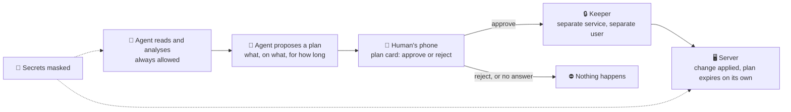

# agent-ops-guardrails, for IT leaders

A plain-language page for a CIO or IT manager deciding whether an AI agent with real server access needs
guardrails like these. Five minutes, no code required. For the full technical picture, see
[the README](../README.md) and [the method](method.md); the version engineers should read is
[the FAQ](faq.md).

## The 30-second version

Giving an AI agent real access to servers is risky — not mainly because the agent is malicious, but because it
can be confidently wrong, or be manipulated into running something it shouldn't, while holding administrator
rights. **agent-ops-guardrails** lets the agent read and analyse freely, but anything the system recognises as a
*change* must first be approved by a human, on their phone, for a limited time — and the agent cannot grant that
approval to itself. ("Recognises" matters: the sorting of commands is a set of rules, not a proof, so this is a
strong safety layer, not a guarantee that nothing can ever slip through.)

## How it works

Three layers, like a safe with three locks. Each covers a different way things go wrong, and none covers the
gaps of another: a change the sorting mistakes for a read never reaches the approval step, and masking does not stop
it either. The approval step is the strong layer; the secret masking is a safety net.

1. **Reading is free, changing is blocked by default.** Every command the agent wants to run is checked (by a
   **hook** — a small, automatic check that runs before the command does, every single time) and sorted into
   "read" or "change." Reads always go through. A change needs step 2. The sorting is done by rules, not by proof: a
   cleverly disguised command that looks like a read can be misjudged. Each such case found is a bug to fix, and the
   reason the project calls this a safety layer and not an absolute barrier.
2. **A change needs a human's explicit approval, on their phone.** The agent writes a **plan**: what it wants
   to do, on what, and for how long. A card with that plan — in plain terms, rights spelled out — arrives on
   the human's phone. They approve or reject with one tap. An approved plan expires on its own after a set
   time, and a single "stop everything" button or command ends every approval immediately, from anywhere (a command that is already running keeps running).
3. **Secrets are masked — a safety net, not a barrier.** A hook refuses a command that might print a secret
   unless its whole output goes through a masking filter, and masks known patterns (keys, tokens, passwords)
   wherever the agent prints something. It runs inside the agent's own process, so — unlike the approval step
   above, which is the strong layer — it catches a cooperative agent's accidents, not a determined, manipulated
   one working around it.

**Why it holds even against a manipulated agent.** The component that holds the approvals — the project calls
it the **keeper** — is a separate service, running as a different user, with files the agent's own account
cannot read or change. The approval itself is a button press on a messaging app the agent cannot read either.
So the agent cannot write itself an approval, replay an old one, or quietly switch the system off. And when the
system cannot classify something with confidence, it treats it as a change and blocks it — the project calls
this **fail-closed**: uncertainty defaults to "ask a human," never to "let it through."

## Evidence and honest limits

| | |
|---|---|
| **Caught in practice** | A week of watching the agent's real activity in dry-run mode (nothing was actually blocked yet) flagged 1,186 commands that would have needed approval as changes. Reviewing that log found a handful of false alarms, which were fixed before any real blocking started. |
| **Tested, not just designed** | More than 500 automated tests across the project's components, run on every change. Each release has generally gone through a review by four AI models from different vendors before being tagged, specifically looking for security and design flaws. A dedicated test suite throws disguised and obfuscated commands at the classifier (quoting tricks, encoding, look-alike characters) to check it isn't fooled by the kind of thing a manipulated agent — or a prompt-injection attack — might try. |
| **In daily use** | The secret-masking layer and the multi-model review already run on the owner's real, if small-scale, infrastructure. The approval mechanism (the "plan card on your phone") has run in block mode on the owner's own laptop since 12/10/2026, after an end-to-end dry run: nine days of everyday work by 21/10/2026, which is what v1.0 (one workstation) rests on. Real use already found things the dry run and the automated tests had not: the "Stop everything" button disappears once a plan is decided, so a standing `/stop` command was added; some approval clicks arrived a minute or two late, which needed its own fix; and the hourly proposal limit, set at 3 to be cautious, was raised to 8 once real work needed more. Each of these is a point in favour of piloting in observe mode first — a young system meets real use with gaps, and that is where you want to find them. |

**Honest limits, stated plainly:**

- This is a **young project**: v1.0 covers one workstation setup, built and proven on one person's homelab. The
  server deployment is documented and has a read-only checker, but has not been applied to a real host yet. It
  is a proof of concept, not a packaged enterprise product.
- **The agent must not run as an administrator.** The approval only holds if the agent's own account cannot edit
  the keeper's files, so the agent has to work under an ordinary user, not as root (the installer refuses root).
- **An approval is an approval.** A plan that allows running a script lets that script do anything the agent's
  user can do: the human decides what to allow, and anything the system recognises as a change waits for that decision.
- It does **not replace** access management, network segmentation, or a human occasionally reviewing what the
  agent has been doing. It is one more layer, not a substitute for the others.
- It **adds friction on purpose**: approval cards take a few seconds of a human's attention. That friction is
  the point, not a bug to optimise away.
- It protects against an agent's **mistakes and manipulation** — a wrong command, a trick that gets it to run
  something harmful. It does **not** protect against a human administrator who already has full rights and
  chooses to misuse them.

## What this changes for an IT department

The underlying idea isn't specific to this one project: it's a reusable pattern for letting an AI agent operate
infrastructure without writing it a blank cheque.

- **Changes need an approval by default.** The agent can look at anything; whatever the system recognises as a change
  needs a separate, logged approval. This is not a restriction on what the agent's account may read.
- **Every approval is traced to a person**, with a scope (what it covers) and a duration (how long it's valid).
- **A decision log** exists independently of the agent, so "what did it almost do, and what did we actually
  approve" is answerable after the fact.

The message underneath all of it: **we are not asking the AI to be perfect. We are building the system so that
one mistake is much less likely to do lasting damage, and is caught early.**

## Likely questions

**What if the agent tries to cheat the approval?**
That is exactly the threat this is designed around, not an edge case. The approval lives outside the agent's
reach (a different service, a different user, files it cannot touch), and a dedicated test suite specifically
tries disguised and obfuscated commands against the classifier to catch the kind of trick a manipulated agent
might use. No guardrail is perfect, which is why the project is upfront that this catches a *cooperative* agent's
mistakes and a *manipulated* agent's tricks, not a determined attacker with unlimited access to rewrite the
agent's own code.

**Does this slow everything down?**
Reads — the large majority of what an agent does day to day — are unaffected. Changes need a human's tap on
their phone, typically a few seconds, and most of that was already supposed to involve a human decision. Early
measurements on real history suggest fewer than half of an agent's past changes had happened within a couple of
hours of an explicit go-ahead from a human — which is the gap this closes, not a cost it adds on top of
something that was already safe.

**Can we deploy this here?**
Start in **observe mode**: the system watches and logs what it *would* block, but blocks nothing. That gives a
real week or two of data — how many changes, how many false alarms, how disruptive the real rhythm would be —
before anyone has to trust it with real blocking. Only move to enforcing mode after that log looks clean.

## How to pilot it

1. **Observe mode first.** Install the classifier in watch-only mode. Let it run against real agent activity
   for at least a week.
2. **Read the log before touching anything.** Look at what it would have blocked: is it mostly real changes
   (good — that's the point), or noise from one routine task it keeps misreading (fix that before moving on)?
3. **Fix the false alarms, and look for the opposite.** Each false alarm is a concrete, testable bug in the classifier,
   not a reason to abandon the approach. Also sample the calls it allowed as reads: a change it let through is the
   costlier mistake, and it will not show up as a refusal.
4. **Switch to blocking mode for a trial period**, with the "stop everything" control tested and understood by
   whoever will hold it, before relying on it for anything that matters.
5. **Keep measuring.** How many approvals per day, how many rejections, how often does the system "fail closed"
   on something a human would have approved — refine the plan's rules, not just file complaints.

---

*This page is one engineer's field notes about one project, not a vendor pitch. For the numbers behind every
claim above, see [docs/results.md](results.md) and [the changelog](../CHANGELOG.md).*
