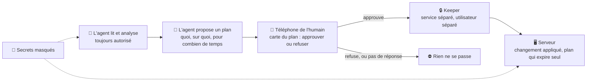

# agent-ops-guardrails, pour les dirigeants IT

Une page en langage simple pour un DSI ou un responsable IT qui se demande si un agent IA ayant un accès réel
aux serveurs a besoin de ce type de garde-fous. Cinq minutes, aucune compétence technique requise. Pour la
vision technique complète, voir [le README](../../README.md) et [la méthode](../method.md) (en anglais) ; la
version destinée aux ingénieurs est [la FAQ](../faq.md).

## En 30 secondes

Donner à un agent IA un accès réel aux serveurs est risqué, mais pas principalement parce que l'agent serait
malveillant. C'est parce qu'il peut se tromper avec une confiance totale, ou être manipulé pour exécuter une
commande qu'il ne devrait pas, tout en détenant des droits d'administrateur. **agent-ops-guardrails** laisse
l'agent lire et analyser librement, mais toute action que le système reconnaît comme un *changement* doit
d'abord être approuvée par un humain, sur son téléphone, pour une durée limitée — et l'agent ne peut pas
s'accorder cette approbation lui-même. (« Reconnaît » compte : le tri des commandes repose sur des règles, pas sur
une preuve ; c'est donc une couche de sécurité solide, pas la garantie que rien ne peut jamais passer.)

## Comment ça marche

Trois couches, comme un coffre-fort à trois serrures. Chacune couvre une façon différente de mal tourner, et
aucune ne couvre les failles d'une autre : un changement que le tri prend pour une lecture n'atteint jamais l'étape
d'approbation, et le masquage ne l'arrête pas non plus. L'approbation est la couche solide ; le masquage des secrets est un filet.

1. **La lecture est libre, le changement est bloqué par défaut.** Chaque commande que l'agent veut exécuter
   est contrôlée (par un **hook** — une vérification automatique qui s'exécute avant la commande, à chaque
   fois) puis classée en « lecture » ou « changement ». Les lectures passent toujours. Un changement a besoin
   de l'étape 2. Le tri est fait par des règles, pas par une preuve : une commande habilement déguisée en lecture
   peut être mal jugée. Chaque cas trouvé est un défaut à corriger, et la raison pour laquelle le projet parle de
   couche de sécurité et non de barrière absolue.
2. **Un changement a besoin de l'approbation explicite d'un humain, sur son téléphone.** L'agent rédige un
   **plan** : ce qu'il veut faire, sur quoi, et pour combien de temps. Une carte avec ce plan — en termes
   clairs, les droits explicités — arrive sur le téléphone de l'humain. Il approuve ou refuse d'un geste. Un
   plan approuvé expire tout seul après une durée fixée, et un unique bouton ou commande « tout arrêter » met
   fin à toutes les approbations immédiatement, depuis n'importe où (une commande déjà en cours continue de tourner).
3. **Les secrets sont masqués — un filet de sécurité, pas une barrière.** Un hook refuse une commande qui
   pourrait afficher un secret, sauf si toute sa sortie passe par un filtre de masquage, et masque les motifs
   connus (clés, jetons, mots de passe) partout où l'agent affiche quelque chose. Il tourne dans le propre
   processus de l'agent : contrairement à l'étape d'approbation ci-dessus, qui est la couche forte, il attrape
   les maladresses d'un agent coopératif, pas les contournements d'un agent manipulé et déterminé.

**Pourquoi ça tient, même face à un agent manipulé.** Le composant qui détient les approbations — le projet
l'appelle le **keeper** (le gardien) — est un service séparé, tournant sous un autre utilisateur, avec des
fichiers que le compte de l'agent ne peut ni lire ni modifier. L'approbation elle-même est une pression sur un
bouton d'une application de messagerie que l'agent ne peut pas lire non plus. L'agent ne peut donc pas
s'écrire une approbation, en rejouer une ancienne, ni désactiver discrètement le système. Et quand le système
ne peut pas classer une commande avec certitude, il la traite comme un changement et la bloque — le projet
appelle ça le **fail-closed** (échec fermé) : dans le doute, le système demande à un humain, jamais il ne
laisse passer.

## Preuves et limites assumées

| | |
|---|---|
| **Ce qui a été intercepté en pratique** | Une semaine d'observation de l'activité réelle de l'agent en mode à blanc (rien n'était encore réellement bloqué) a repéré 1186 commandes qui auraient nécessité une approbation en tant que changements. L'examen de ce journal a révélé une poignée de fausses alertes, corrigées avant le début du blocage réel. |
| **Testé, pas seulement conçu** | Plus de 500 tests automatisés sur l'ensemble des composants du projet, exécutés à chaque modification. La plupart des versions publiées sont passées par une revue de quatre modèles d'IA de fournisseurs différents avant d'être taguées, spécifiquement pour chercher des failles de sécurité et de conception. Une suite de tests dédiée soumet au classifieur des commandes déguisées et obfusquées (astuces de guillemets, encodages, caractères visuellement trompeurs) pour vérifier qu'il n'est pas dupé par le genre de ruse qu'un agent manipulé — ou une attaque par injection de prompt — pourrait tenter. |
| **En usage quotidien** | La couche de masquage des secrets et la revue multi-modèle tournent déjà sur l'infrastructure réelle, bien que modeste, du créateur du projet. Le mécanisme d'approbation (la « carte de plan sur le téléphone ») tourne en mode bloquant sur l'ordinateur réel du créateur depuis le 12/10/2026, après une répétition complète à blanc : neuf jours de travail quotidien au 21/10/2026, sur lesquels s'appuie la version 1.0 (un poste de travail). L'usage réel a déjà révélé des choses que la répétition et les tests automatisés n'avaient pas vues : le bouton « Tout arrêter » disparaît une fois qu'un plan est décidé, d'où l'ajout d'une commande `/stop` permanente ; certains clics d'approbation arrivaient avec une à deux minutes de retard, ce qui a nécessité un correctif dédié ; et la limite horaire de propositions, fixée par prudence à 3, a été relevée à 8 une fois que le travail réel l'a exigé. Chacun de ces points plaide pour piloter d'abord en mode observation : un système jeune révèle des failles à l'usage réel, et c'est justement là qu'on veut les trouver. |

**Limites assumées, dites sans détour :**

- C'est un **projet jeune** : la version 1.0 couvre un poste de travail, construit et éprouvé sur l'environnement
  personnel d'une seule personne. Le déploiement sur serveur est documenté et dispose d'un vérificateur en lecture
  seule, mais n'a pas encore été appliqué sur une vraie machine. C'est une preuve de concept, pas un
  produit d'entreprise packagé.
- **L'agent ne doit pas tourner en administrateur.** L'approbation ne tient que si le compte de l'agent ne peut
  pas modifier les fichiers du keeper : l'agent doit travailler sous un utilisateur ordinaire, pas en root
  (l'installateur refuse root).
- **Une approbation reste une approbation.** Un plan qui autorise l'exécution d'un script laisse ce script faire
  tout ce que l'utilisateur de l'agent peut faire : l'humain décide de ce qu'il autorise, tout ce que le système reconnaît
  comme un changement attend cette décision.
- Il **ne remplace pas** la gestion des accès, la segmentation réseau, ni une relecture humaine occasionnelle
  de ce que l'agent a fait. C'est une couche supplémentaire, pas un substitut aux autres.
- Il **ajoute de la friction volontairement** : les cartes d'approbation demandent quelques secondes
  d'attention humaine. Cette friction est le but recherché, pas un défaut à optimiser.
- Il protège contre les **erreurs et les manipulations** de l'agent — une mauvaise commande, une ruse qui le
  pousse à exécuter quelque chose de nuisible. Il ne protège **pas** contre un administrateur humain qui a déjà
  tous les droits et choisit d'en abuser.

## Ce que ça change pour une direction IT

L'idée sous-jacente ne se limite pas à ce seul projet : c'est un schéma réutilisable pour autoriser un agent IA
à opérer une infrastructure sans lui signer un chèque en blanc.

- **Les changements demandent une approbation par défaut.** L'agent peut tout regarder ; tout ce que le système reconnaît comme un
  changement a besoin d'une approbation séparée et tracée.
- **Chaque approbation est rattachée à une personne**, avec un périmètre (ce qu'elle couvre) et une durée
  (sa validité).
- **Un journal de décision** existe indépendamment de l'agent, pour pouvoir répondre après coup à « qu'a-t-il
  presque fait, et qu'avons-nous réellement approuvé ».

Le message de fond : **on ne demande pas à l'IA d'être parfaite. On construit le système pour qu'une erreur ait
beaucoup moins de chances de faire des dégâts durables, et soit repérée tôt.**

## Questions probables

**Et si l'agent essaie de tricher avec l'approbation ?**
C'est exactement la menace que ce système est conçu pour contrer, pas un cas marginal. L'approbation vit hors
de portée de l'agent (un autre service, un autre utilisateur, des fichiers qu'il ne peut pas toucher), et une
suite de tests dédiée soumet spécifiquement des commandes déguisées et obfusquées au classifieur pour attraper
le genre de ruse qu'un agent manipulé pourrait employer. Aucun garde-fou n'est parfait, c'est pourquoi le
projet précise d'emblée qu'il attrape les erreurs d'un agent *coopératif* et les ruses d'un agent *manipulé*,
pas un attaquant déterminé ayant un accès illimité pour réécrire le code de l'agent lui-même.

**Est-ce que ça ralentit tout ?**
Les lectures — la grande majorité de ce qu'un agent fait au quotidien — ne sont pas affectées. Les changements
demandent un geste de l'humain sur son téléphone, généralement quelques secondes, et la plupart impliquaient
déjà, en principe, une décision humaine. Des premières mesures sur l'historique réel suggèrent que moins de la
moitié des changements passés de l'agent avaient eu lieu dans les deux heures suivant un feu vert explicite
d'un humain — c'est l'écart que ce système referme, pas un coût qu'il ajoute à quelque chose qui était déjà
sûr.

**Peut-on déployer ça chez nous ?**
Commencez en **mode observation** : le système observe et journalise ce qu'il *aurait* bloqué, sans rien
bloquer réellement. Cela donne une ou deux vraies semaines de données — combien de changements, combien de
fausses alertes, quelle serait la perturbation du rythme réel — avant que quiconque ait à lui confier un
blocage réel. Ne passez en mode bloquant qu'une fois ce journal propre.

## Comment le piloter

1. **Mode observation d'abord.** Installez le classifieur en mode surveillance uniquement. Laissez-le tourner
   contre l'activité réelle de l'agent pendant au moins une semaine.
2. **Lisez le journal avant de toucher à quoi que ce soit.** Regardez ce qu'il aurait bloqué : surtout de
   vrais changements (c'est bon signe, c'est le but), ou du bruit causé par une tâche routinière mal
   interprétée (à corriger avant d'aller plus loin) ?
3. **Corrigez les fausses alertes, et cherchez l'inverse.** Chaque fausse alerte est un bug concret et testable du classifieur, pas une raison
   d'abandonner l'approche. Échantillonnez aussi les appels qu'il a laissés passer comme des lectures : un changement laissé passer est l'erreur la plus coûteuse, et elle n'apparaît pas comme un refus.
4. **Passez en mode bloquant pour une période d'essai**, avec le contrôle « tout arrêter » testé et compris
   par la personne qui le détiendra, avant de s'y fier pour quoi que ce soit d'important.
5. **Continuez à mesurer.** Combien d'approbations par jour, combien de refus, à quelle fréquence le système
   « échoue fermé » sur quelque chose qu'un humain aurait approuvé — affinez les règles du plan, ne vous
   contentez pas de vous plaindre.

---

*Cette page relate les observations de terrain d'une seule personne sur un seul projet, ce n'est pas un
argumentaire commercial. Pour les chiffres derrière chaque affirmation ci-dessus, voir
[docs/results.md](../results.md) et [le changelog](../../CHANGELOG.md) (en anglais).*
